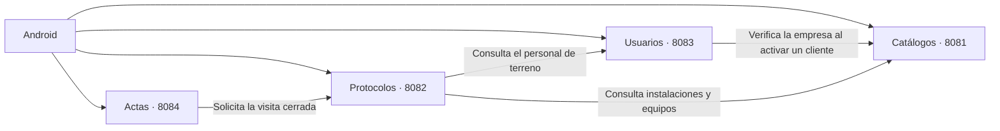

# InduztekSPA · Parcial 4 DSY1105

[Instrucciones y pauta oficial](Ev.%20Parcial%204_Encargo_Estudiante_%20DSY1105.pdf)

## Microservicios propios

Los cuatro módulos se ejecutan por separado con Spring Boot. Catálogos, Protocolos y Usuarios tienen almacenes independientes. La configuración local de Laragon usa MySQL con un esquema por servicio. H2 está disponible para instalaciones nuevas y para las pruebas. Usuarios autentica las cuentas y administra el alta y el estado de clientes. Actas consulta a Protocolos para entregar la copia sincronizada. Protocolos consulta a Catálogos para comprobar empresa, instalación, equipo, instrumento y calibración. [Configuración de Laragon](../README.md#base-mysql-en-laragon)



Catálogos, Protocolos y Actas también consultan a Usuarios para autenticar las peticiones que reciben. El módulo `common` comparte esa configuración de seguridad y otras clases Java. Spring Boot lo carga como una biblioteca de los cuatro servicios.

Los cuatro servicios publican su contrato OpenAPI y cuentan con Swagger UI. Durante la defensa puedes abrir **Authorize** para usar la cuenta correspondiente y ejecutar una consulta de ejemplo. [Direcciones de Swagger UI](../README.md#swagger-ui--openapi)

| Módulo | Archivos para seguir una petición | Esquema MySQL |
| --- | --- | --- |
| `catalog-service` | `CatalogController` recibe la petición y `CatalogService` aplica las reglas del catálogo. | `induztek_catalogos` |
| `protocol-service` | `ProtocolController` recibe los cambios. `ProtocolService` valida y guarda la visita, el protocolo o la medición. | `induztek_protocolos` |
| `access-service` | `SessionController` devuelve el perfil autenticado. `CuentasController` gestiona el registro y los permisos. `PerfilController` registra los ingresos y maneja las fotos. | `induztek_usuarios` |
| `report-service` | `ReportController` solicita a Protocolos el acta y añade su huella SHA-256. | Usa el acta guardada en Protocolos. |

Para seguir el flujo en la defensa, abre una visita cerrada y pulsa **Consultar copia sincronizada**. Android pide el acta a Actas. Actas solicita la visita a Protocolos, que comprueba el acceso y devuelve el texto guardado. Android recibe la copia con su huella SHA-256 y comprueba que ambos coincidan.

| Servicio | Endpoint | Función |
| --- | --- | --- |
| Catálogos, 8081 | `GET /api/session` | Identificar al usuario de la sincronización |
| Catálogos, 8081 | `GET /api/snapshot` | Leer clientes, instalaciones, equipos, instrumentos y calibraciones |
| Catálogos, 8081 | `POST /api/events` | Recibir altas y actualizaciones de catálogo |
| Protocolos, 8082 | `GET /api/snapshot` | Leer visitas, protocolos, pruebas, mediciones e historial |
| Protocolos, 8082 | `POST /api/events` | Crear y actualizar visitas y protocolos, registrar, editar o eliminar pruebas, cerrar visitas y cambiar estados |
| Protocolos, 8082 | `GET /api/actas/{visitaId}` | Entregar a Actas la visita cerrada si el usuario puede consultarla |
| Usuarios, 8083 | `GET /api/session` | Verificar la credencial de una cuenta activa y devolver su perfil |
| Usuarios, 8083 | `POST /api/ingresos` | Registrar el inicio de sesión de Android tras validar los cuatro servicios |
| Usuarios, 8083 | `GET /api/perfil/foto`, `PUT /api/perfil/foto` | Descargar o guardar el JPEG de la cuenta autenticada |
| Usuarios, 8083 | `POST /api/registro` | Guardar una solicitud de cuenta cliente pendiente de aprobación |
| Usuarios, 8083 | `GET /api/personal` | Consultar el directorio interno para seleccionar y validar el equipo de terreno |
| Usuarios, 8083 | `GET /api/cuentas`, `POST /api/cuentas`, `PATCH /api/cuentas/{id}/permisos` | Crear cuentas y gestionar roles, empresa asociada y estado desde el perfil jefe técnico |
| Usuarios, 8083 | `GET /api/cuentas/clientes`, `POST /api/cuentas/clientes`, `PATCH /api/cuentas/clientes/{id}/estado` | Listar, crear o cambiar el estado de cuentas cliente como jefe técnico |
| Actas, 8084 | `GET /api/actas/{visitaId}` | Entregar el texto sincronizado con una huella SHA-256 que Android comprueba |

La app escribe primero en Room. Los cambios quedan en una cola por usuario hasta que el servidor confirma su identificador. La última revisión del protocolo se valida al actualizarlo. Las pruebas de un protocolo editable admiten eliminación junto con sus mediciones. La siguiente descarga de ese protocolo elimina la copia en otros dispositivos. Los protocolos bloqueados conservan sus pruebas.

Android valida la credencial con Usuarios y verifica la misma cuenta en Catálogos, Protocolos y Actas a través de sus endpoints `GET /api/servicios/{servicio}`. Si falla un servicio, la app muestra el error y permanece en el inicio de sesión. **Registrarse** guarda una solicitud que el jefe técnico debe aprobar y asociar a una empresa verificada por Catálogos. Tras iniciar sesión, Room conserva el trabajo en terreno si se interrumpe la conexión. **Consultar copia sincronizada** solicita a Actas la versión guardada en Protocolos.

Al construir las descargas, los servicios usan conjuntos de identificadores para relacionar instalaciones, visitas, protocolos, pruebas y mediciones sin recorrer la lista padre por cada registro. Retrofit reutiliza el cliente HTTP entre sincronizaciones.

## Demostración

1. Configura las contraseñas iniciales del jefe técnico, técnico e ingeniero según el [README](../README.md#ejecutar). Desde la raíz, ejecuta `./scripts/IniciarBackend.cmd` con un emulador activo o un dispositivo conectado por USB. El script configura ADB reverse para los puertos 8081 a 8084.
2. Abre la app como técnico con la contraseña configurada. En **Visitas y actas de terreno**, crea una visita para Planta Molienda con una OT nueva, un ingeniero y un participante.
3. En la visita, consulta el clima de **Puente Alto**. La app muestra temperatura, humedad y hora local de Open-Meteo como referencia meteorológica. Los campos de medición del protocolo se editan aparte.
4. Inicia un protocolo para `REL-50/51-A`. Guarda el ambiente y registra la prueba **Operación de relé**, elemento **50/51**, con un instrumento vigente. Por ejemplo, ajuste 5 A, corriente 5,1 A, tiempo esperado 100 ms y medido 104 ms.
5. En el detalle del protocolo, consulta el resultado, selecciona **Editar prueba** y cambia el tiempo medido a 102 ms. En el panel, abre **Sincronización y conexión** y pulsa **Sincronizar ahora** para demostrar el envío y la lectura. Vuelve al protocolo editable, usa **Eliminar prueba** y sincroniza de nuevo.
6. Registra una prueba válida nuevamente, registra el protocolo en terreno y cierra la visita. Sincroniza, abre el acta y pulsa **Consultar copia sincronizada**. Luego entra con el perfil ingeniero y formaliza.
7. Cierra sesión y envía una solicitud desde **Registrarse**. Entra como jefe técnico, abre **Administrar cuentas**, selecciona la empresa y pulsa **Aprobar y activar**. Usa **Cambiar cuenta → Agregar otra cuenta** para entrar con la cuenta creada y comprobar el catálogo de la empresa asignada. Repite para las cuentas de terreno y revisión para alternar entre las cuatro vistas.

Open-Meteo recibe la comuna chilena en `GET /v1/search` de `geocoding-api.open-meteo.com`. La app usa las coordenadas de la localidad devuelta en `GET /v1/forecast` de `api.open-meteo.com` y solicita `current=temperature_2m,relative_humidity_2m` con `timezone=auto`. Si falla la consulta, se puede seguir editando la visita. [Geocodificación](https://open-meteo.com/en/docs/geocoding-api) · [Variables meteorológicas](https://open-meteo.com/en/docs)

## Portal de clientes

Ingresa con una cuenta cliente y abre **Trabajos**. El portal muestra la orden de trabajo, su instalación, la fecha y el estado de la visita o de sus protocolos. En el detalle se ven las pruebas realizadas y los resultados de protocolos formalizados. Si la visita cerrada tiene un acta publicada, pulsa **Ver acta de terreno** y luego **Consultar copia sincronizada** o **Guardar acta en PDF**. **Mis equipos** muestra los equipos asociados a la empresa.

El portal consulta Catálogos y Protocolos con la sesión del cliente y muestra la fecha de la última consulta. Las órdenes y actas provienen de la empresa vinculada a esa cuenta.

## APIs nativas de Android

| API | Cómo demostrarla |
| --- | --- |
| Cámara y selector de fotos | En **Mi perfil**, toma una foto o elige una de la galería. |
| Ubicación aproximada | Abre una visita y pulsa **Consultar clima con mi ubicación**. Android pide permiso mientras usas la app. La consulta envía a Open-Meteo coordenadas aproximadas para obtener el clima. |
| Notificaciones | En **Sincronización y conexión**, activa **Notificar al sincronizar** y pulsa **Sincronizar ahora**. Abre la bandeja de Android para ver la confirmación. Las sincronizaciones automáticas avisan cuando envían cambios. |

## Pruebas y firma

```powershell
$env:JAVA_HOME = 'C:/Program Files/Android/Android Studio/jbr'
./gradlew.bat -p backend test bootJar
./gradlew.bat :app:createValidacionUnitTestCoverageReport
powershell.exe -NoProfile -ExecutionPolicy Bypass -File scripts/MedirCoberturaLogica.ps1
./gradlew.bat :app:connectedValidacionAndroidTest '-Pandroid.testInstrumentationRunnerArguments.notAnnotation=' '-Pandroid.testInstrumentationRunnerArguments.backendIntegration=true'
powershell.exe -NoProfile -ExecutionPolicy Bypass -File scripts/GenerarApkEntrega.ps1
```

La instrumentación de integración requiere los cuatro servicios, un emulador o dispositivo y una base de prueba con `INDUZTEK_DEMO=true`. Crea una visita y solicita una cuenta en el servidor de prueba. La salida JaCoCo se genera en `app/build/reports/coverage/test/validacion/`, con reporte HTML y XML. El APK firmado queda en `app/build/outputs/apk/entrega/app-entrega.apk`. El script verifica el certificado con `apksigner` y reutiliza el JKS local para futuras compilaciones.

La copia lista para instalar está en [InduztekSPA-Parcial4.apk](entrega/InduztekSPA-Parcial4.apk). [Verificación de la firma](evidencias/firma-apk.txt)

La revisión con Laragon pasó 43 pruebas unitarias de Android, 14 pruebas del backend y 4 pruebas básicas en el emulador. Con el APK firmado se comprobó directamente en MySQL la persistencia de una solicitud de registro, los ingresos, fotos de perfil de cámara y galería, una medición de aislación y la creación y actualización del protocolo de la visita `OT-LARAGON-2211`. La suite instrumentada completa requiere un backend de prueba con datos propios.

En la revisión anterior se documentaron estas pantallas en el emulador API 37. [Consulta de Actas](evidencias/apk-acta-remota.png) · [Sincronización](evidencias/apk-sincronizacion.png) · [Open-Meteo](evidencias/apk-clima.png)

La evidencia anterior documenta pruebas de alta directa desde Compose, persistencia tras reiniciar Usuarios, bloqueo al desactivar la cuenta y rechazo de acceso a una empresa ajena. [Resultado del emulador](evidencias/pruebas-emulador.txt)

La revisión con el portal de clientes pasó 47 pruebas unitarias de Android. JaCoCo midió **81,39 % de cobertura de líneas de lógica (1076/1322)** en `data`, `model`, `sync` y `viewmodel`. El cálculo excluye las implementaciones que genera Room y supera el 80 % que exige la pauta. [Desglose por paquete](evidencias/cobertura-logica.txt)

Si el emulador de API 37 devuelve `Invalid userId -2`, puedes compilar con `:app:assembleValidacion :app:assembleValidacionAndroidTest` e invocar el runner directamente:

```powershell
$adb = Join-Path $env:LOCALAPPDATA 'Android/Sdk/platform-tools/adb.exe'
& $adb install --user 0 -r app/build/outputs/apk/validacion/app-validacion.apk
& $adb install --user 0 -r app/build/outputs/apk/androidTest/validacion/app-validacion-androidTest.apk
& $adb shell am instrument --user 0 -w -e backendIntegration true cl.induztek.app.validacion.test/androidx.test.runner.AndroidJUnitRunner
```

La variante académica `entrega` compila con la optimización desactivada para evitar un fallo de arranque de WorkManager al optimizar solo ciertos paquetes. La llave queda en `%LOCALAPPDATA%\InduztekSPA\FirmaParcial4\induztek-parcial4.jks`. Las contraseñas quedan protegidas por la cuenta de Windows. El repositorio público puede contener el APK y la configuración de compilación. Para la entrega privada acordada con el docente, comparte la llave académica por el canal indicado.

## Evidencia de la pareja

[Tablero InduztekSPA en Trello](https://trello.com/b/gePUFvO5/induztekspa) · [Repositorio InduztekSPA en GitHub](https://github.com/N3rd11/InduztekSPA)

| Tarjeta para la Parcial 4 | Evidencia que debe quedar asociada |
| --- | --- |
| Backend y CRUD de pruebas | Commit del servicio de protocolos, prueba de integración y revisión de permisos |
| API externa y flujo de visita | Commit de Retrofit, prueba del repositorio y captura del clima en una visita |
| Cobertura y APK firmado | Reporte JaCoCo, certificado verificado y comprobación de instalación |
| Defensa y entrega | Ensayo del recorrido, revisión cruzada y comprobación de acceso del docente |

- Registrar en las tarjetas las contribuciones reales de cada integrante y vincular sus commits o revisiones.
- Añadir a la entrega la evidencia de Trello, los resultados de las pruebas, el APK firmado y el material de firma solicitado.
- Verificar el acceso del docente al repositorio y entregar el encargo grupal en AVA. Cada integrante debe completar su activación individual dentro del plazo.
