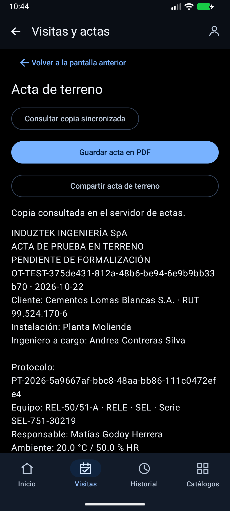
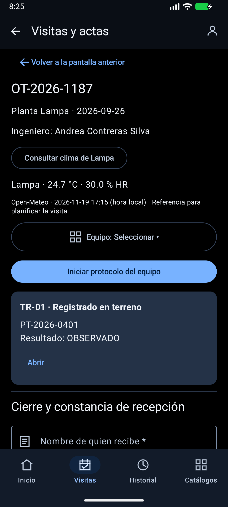

# InduztekSPA

**Del registro de pruebas eléctricas en terreno al acta que recibe el cliente.**

InduztekSPA es una aplicación Android para empresas de servicios eléctricos que necesitan registrar mediciones, revisar protocolos y entregar un respaldo de cada trabajo. Cada registro queda asociado a una orden de trabajo, una instalación y los equipos intervenidos. Así, el equipo puede reconstruir **qué se hizo, qué resultado tuvo y en qué etapa está**, incluso después de terminada la visita.

La aplicación conecta tres momentos del mismo trabajo. El técnico registra lo realizado en terreno, ingeniería revisa y formaliza los resultados, y el cliente consulta los trabajos publicados de su empresa desde su propio portal.

[Ver la aplicación](Docs/evidencias/apk-acta-remota.png) · [Descargar el APK firmado](Docs/entrega/InduztekSPA-Parcial4.apk) · [Seguir una demostración](Docs/ENTREGA_PARCIAL4.md#demostración)

## Qué resuelve

En un servicio en terreno, una misma visita puede dejar mediciones, protocolos por equipo y un acta de recepción. Cuando esos datos quedan repartidos en hojas y archivos, es difícil reconstruir el trabajo o distinguir un resultado registrado de uno ya formalizado.

InduztekSPA reúne ese recorrido bajo la misma orden de trabajo. En terreno se capturan los datos por equipo. En revisión, el historial muestra los cambios de estado del protocolo. En el portal cliente, la empresa puede consultar el avance y abrir el acta publicada cuando esté disponible.

<table>
  <tr>
    <td></td>
    <td></td>
  </tr>
  <tr>
    <td>Consulta del acta sincronizada</td>
    <td>Clima de referencia en una visita</td>
  </tr>
</table>

## Cómo se usa en terreno

1. **Abrir una visita.** El técnico registra la orden de trabajo, selecciona la instalación y asigna el equipo de trabajo. Desde esa visita abre un protocolo por equipo intervenido.
2. **Registrar las pruebas.** La aplicación guía el ingreso de mediciones según el tipo de equipo y prueba. Para las pruebas con cálculo disponible, permite revisar el resultado antes de guardar.
3. **Conservar el avance.** Después de iniciar sesión, el técnico puede seguir guardando borradores y cambios durante un corte de conexión. La aplicación los mantiene en el dispositivo y los envía cuando vuelve a estar disponible el servidor.
4. **Cerrar la visita y revisar los resultados.** El equipo registra la recepción del trabajo y genera el acta de terreno. Ingeniería revisa los protocolos y formaliza los resultados con su perfil.
5. **Consultar el respaldo.** El cliente busca la orden de trabajo o la instalación, revisa lo publicado y puede consultar o guardar el acta en PDF.

### Equipos y pruebas

La aplicación contempla **transformadores, interruptores, celdas de media tensión, cables de poder y relés de protección**. Según el equipo, el protocolo admite pruebas de resistencia de aislación, relación de transformación, resistencia de devanados, resistencia de contactos y operación de relé.

En trabajos de mantenimiento se pueden registrar mediciones previas y posteriores. Si una prueba aplicable queda sin realizarse, el técnico puede registrar el motivo. Las evaluaciones que requieren criterio técnico quedan disponibles para revisión manual.

## Una vista para cada responsabilidad

| Rol | Qué puede hacer |
| --- | --- |
| **Técnico de terreno** | Crear visitas, registrar pruebas y mediciones, y generar el acta al cerrar una visita. |
| **Ingeniero de pruebas** | Revisar resultados e historial, registrar observaciones y formalizar protocolos. |
| **Jefe técnico** | Supervisar el trabajo, administrar instrumentos y calibraciones, y gestionar cuentas, roles y permisos. |
| **Cliente** | Buscar trabajos, revisar las pruebas publicadas y consultar los equipos y actas de su empresa. |

El registro de un cliente comienza como una solicitud pendiente. Un jefe técnico la revisa, asigna la empresa y activa el acceso. El portal muestra la fecha de la última consulta al servidor y distingue una **visita en curso**, un trabajo **en revisión técnica** y los **protocolos formalizados**. El acta de terreno y el estado de formalización se presentan por separado.

### Funciones del teléfono

En una visita abierta, el técnico puede consultar **temperatura y humedad** para la comuna de la instalación o la ubicación aproximada de su dispositivo. La app pide permiso al usar la ubicación y muestra el clima como referencia para planificar el trabajo. También permite tomar o elegir una foto de perfil y activar avisos de Android al completar una sincronización.

## Probar la aplicación

La versión disponible en este repositorio es una **demostración académica instalable**. Para probarla se necesita el backend en ejecución y un emulador o teléfono con **Android 8 o posterior**. En Windows, la primera compilación del backend requiere **JDK 17 o posterior** y conexión para descargar las dependencias.

1. Abre el emulador o conecta un teléfono por USB con depuración habilitada. El arranque usa Android SDK Platform-Tools para configurar ADB cuando detecta un dispositivo autorizado.
2. Arranca los servicios con [IniciarBackendLocal.bat](IniciarBackendLocal.bat) para usar H2 o con [IniciarBackendLaragon.bat](IniciarBackendLaragon.bat) para usar MySQL de Laragon. En una base nueva, ejecuta [ConfigurarJefeTecnico.bat](ConfigurarJefeTecnico.bat) para definir la clave inicial. El correo de esa cuenta es `respinoza@induztek.ejemplo`.
3. Instala el [APK firmado](Docs/entrega/InduztekSPA-Parcial4.apk) e inicia sesión. Desde **Administrar cuentas**, el jefe técnico puede preparar los perfiles de la demostración. Para mostrar el portal, usa una cuenta cliente de la empresa de la visita que vas a presentar.

Los servicios quedan activos en los puertos **8081–8084**. [DetenerMicroservicios.bat](DetenerMicroservicios.bat) permite cerrar los procesos de esta copia del proyecto. El [recorrido completo de demostración](Docs/ENTREGA_PARCIAL4.md#demostración) incluye un ejemplo de pruebas de relé, formalización y consulta del acta.

## Arquitectura y documentación de la API

Android está desarrollado con **Kotlin, Jetpack Compose y Material 3**. Usa **Room sobre SQLite** para el almacenamiento local y **Retrofit** para las peticiones HTTP. El backend está dividido en cuatro servicios **Spring Boot**. Catálogos, Protocolos y Usuarios tienen almacenamiento propio, con H2 para ejecución local o esquemas MySQL independientes al usar Laragon. Actas consulta a Protocolos para entregar la copia sincronizada.

| Microservicio | Responsabilidad | Documentación local |
| --- | --- | --- |
| **Catálogos** | Empresas, instalaciones, equipos, instrumentos y calibraciones. | [Swagger UI · 8081](http://localhost:8081/swagger-ui.html) · [OpenAPI](http://localhost:8081/v3/api-docs) |
| **Protocolos** | Visitas, pruebas, mediciones e historial de formalización. | [Swagger UI · 8082](http://localhost:8082/swagger-ui.html) · [OpenAPI](http://localhost:8082/v3/api-docs) |
| **Usuarios** | Registro, autenticación, roles, permisos e imágenes de perfil. | [Swagger UI · 8083](http://localhost:8083/swagger-ui.html) · [OpenAPI](http://localhost:8083/v3/api-docs) |
| **Actas** | Entrega la copia del acta con una huella SHA-256 para que Android compruebe su integridad. | [Swagger UI · 8084](http://localhost:8084/swagger-ui.html) · [OpenAPI](http://localhost:8084/v3/api-docs) |

Los enlaces de Swagger se abren en el navegador del PC que ejecuta el backend. Usa **Authorize** para probar las operaciones protegidas con el rol correspondiente. Las contraseñas se guardan como hashes **BCrypt** y el backend valida los permisos de las operaciones. Para el clima, Retrofit consulta a **Open-Meteo** mediante `GET /v1/search` para buscar una comuna y `GET /v1/forecast` para obtener temperatura y humedad.

[Ver el diagrama de servicios y los endpoints](Docs/ENTREGA_PARCIAL4.md#microservicios-propios)

## Pruebas y entrega académica

| Verificación | Herramientas | Último resultado |
| --- | --- | --- |
| Unitarias de Android | JUnit 4 y Robolectric | 47 aprobadas |
| Backend | JUnit 5 y Spring Boot Test | 15 aprobadas |
| Instrumentación básica en emulador | AndroidJUnitRunner, Compose UI Test y Espresso | 4 aprobadas |
| Cobertura de líneas de lógica | JaCoCo | 81,39 % (1076 de 1322 líneas) |

Para ejecutar las pruebas de Android y del backend desde la raíz del proyecto:

```powershell
.\gradlew.bat :app:testValidacionUnitTest :app:createValidacionUnitTestCoverageReport
.\gradlew.bat -p backend test
```

Las pruebas instrumentadas que recorren el flujo completo requieren un emulador o dispositivo y un backend con datos de prueba. La guía de entrega describe cómo preparar ese entorno.

**Desarrollo académico · DSY1105, Parcial 4**

Francisco Gutierrez · [Tablero del proyecto](https://trello.com/b/gePUFvO5/induztekspa)

[Guía de entrega](Docs/ENTREGA_PARCIAL4.md) · [Evidencia de cobertura](Docs/evidencias/cobertura-logica.txt) · [Verificación de firma del APK](Docs/evidencias/firma-apk.txt)
